# CARA-OT

**Cross-Artifact Change Impact and Recovery Assurance for Operational Technology**

When one maintenance visit changes a PLC program, an HMI alarm and a firewall rule within minutes, existing tools report three changed files. CARA-OT reports **one chain of related changes**: what exactly changed, which equipment it can affect, whether anyone approved it, and whether the plant can be restored from its backups. A local LLM then explains the evidence in plain English, and the asset IDs and measured values it writes are checked against that evidence.

-000000)

> **This is a showcase repository.** It contains the project description, architecture, screenshots, results and selected code excerpts. The full source code is kept in a private repository and is available to recruiters and examiners on request.

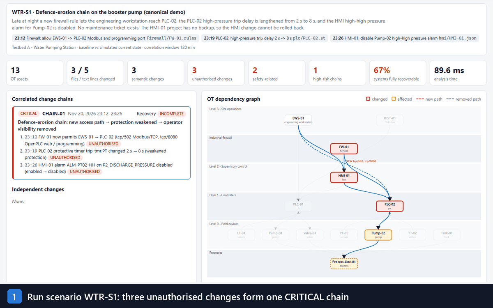

## The problem

OT environments (PLCs, HMI/SCADA, engineering workstations, industrial firewalls, drives) change constantly through maintenance and engineering work. A file-hash or text-diff tool can say *that* a file changed. It cannot say which parameter moved, that a firewall change and a PLC change minutes later touch the same controller, which pump sits downstream, whether a ticket approved the work, or whether a verified backup exists to roll it back.

## What CARA-OT answers

The reference scenario, **WTR-S1** on a simulated water pumping station, combines three changes made between 23:12 and 23:26:

| Question | CARA-OT's answer for WTR-S1 |
|---|---|
| What exactly changed? | Firewall FW-01 now allows EWS-01 → PLC-02 (tcp/502 Modbus, tcp/8080 OpenPLC programming); PLC-02 protective timer `trip_tmr.PT` 2 s → 8 s; HMI alarm `ALM-PT02-HH` disabled |
| Do the changes belong together? | Yes: each one reaches PLC-02, 7 minutes after the previous one, so they form one chain |
| What could be affected? | Pump-02 and Process-Line-01, each with the dependency-graph path that reaches it |
| Was it approved? | No: no maintenance ticket covers any of the three changes |
| Can it be recovered? | Not fully: 3 of 4 required backup components verified; the HMI-01 project backup is missing |
| How serious is it? | CRITICAL, risk score 18: new access path → protection weakened → operator visibility removed |

## Architecture

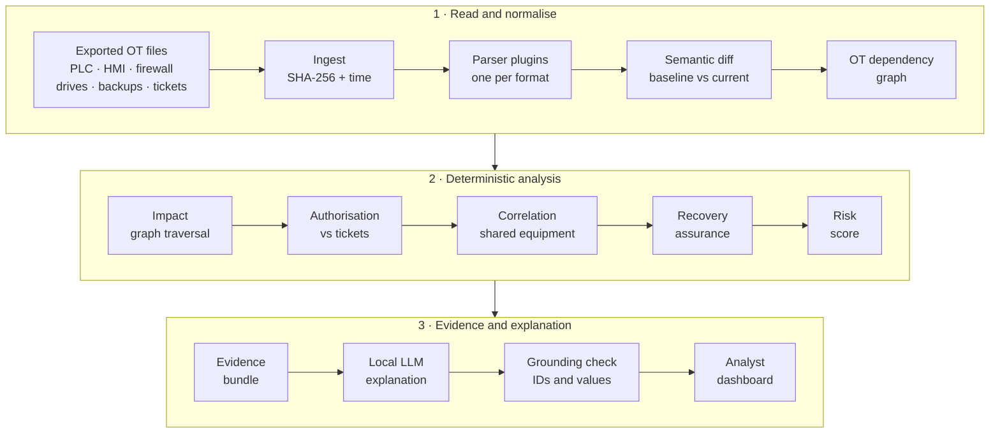

Three design decisions shape the system:

- **Deterministic evidence; the AI only explains.** Every finding comes from the engines above. The LLM only rewrites the evidence bundle in plain English, and a checker verifies that the asset IDs and measured values (numbers with units) it writes appear in that bundle. If the model is unavailable, a template explanation is used instead.
- **Read-only by design.** CARA-OT analyses exported files and has no write path to PLCs, HMIs or firewalls.
- **Plugin parsers, one model.** Each file format is a parser plugin that emits the same entities and typed relations, so the analysis engines never see vendor formats.

<b>Worked example:</b> the pipeline with WTR-S1's measured values

 
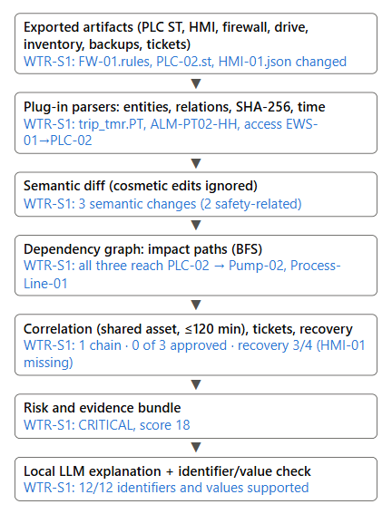

## Demo

The dashboard runs locally (FastAPI back end, plain HTML/CSS/JavaScript front end). Scenario event times in the screenshots are simulated.

**Water pumping station, WTR-S1.** One CRITICAL chain of three unauthorised changes, with the graph path to the affected pump.

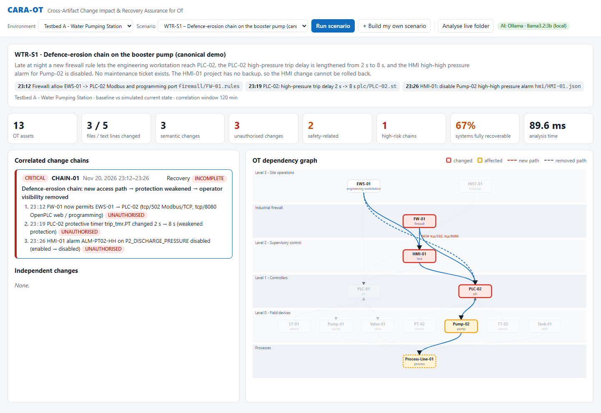

**Chain detail.** Why the changes are linked, potential impact, recovery assurance and the transparent risk score.

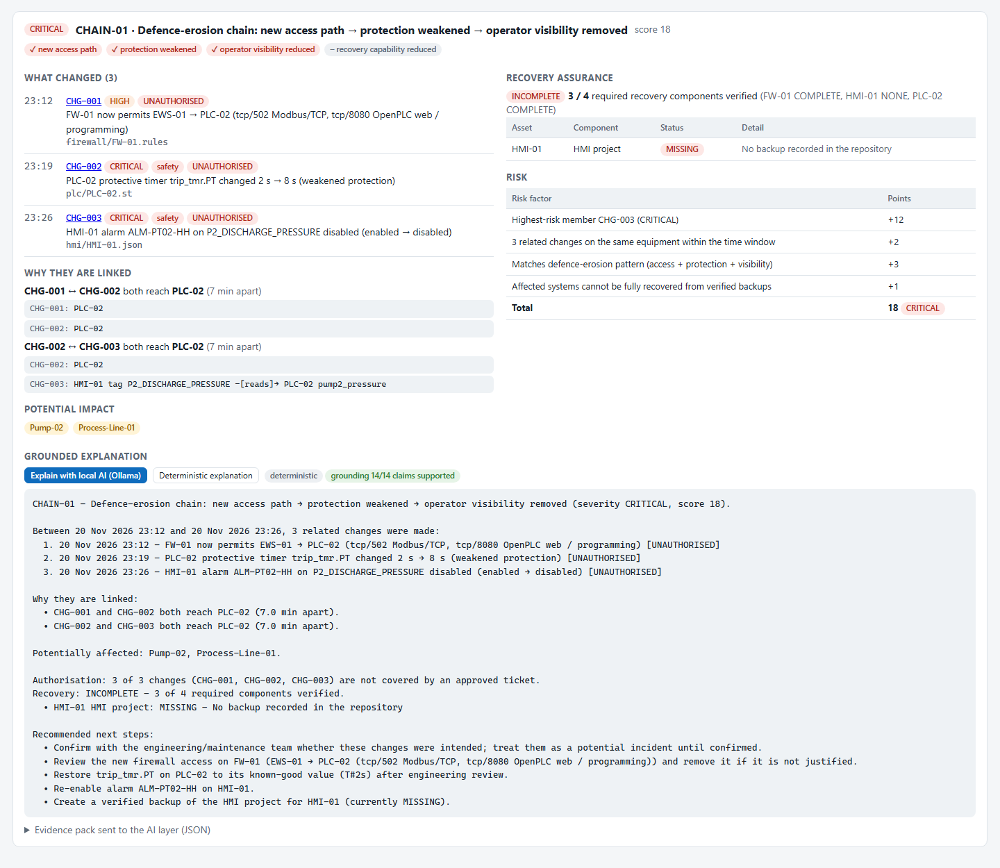

**Packaging line, MFG-M1.** The same engines on a second plant: four unauthorised changes across firewall, PLC, drive and HMI form one chain.

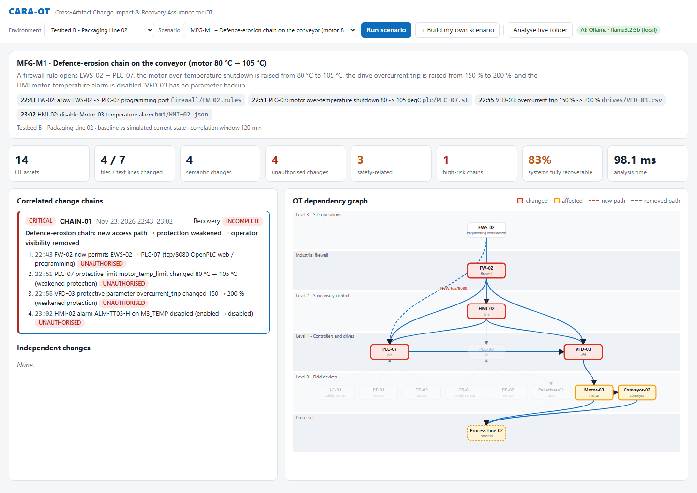

**Recovery assurance, WTR-S3.** Each backup is checked for presence, SHA-256 integrity and content/version; a missing HMI project, a missing PLC program and a corrupted firmware image leave 3 of 6 systems fully recoverable.

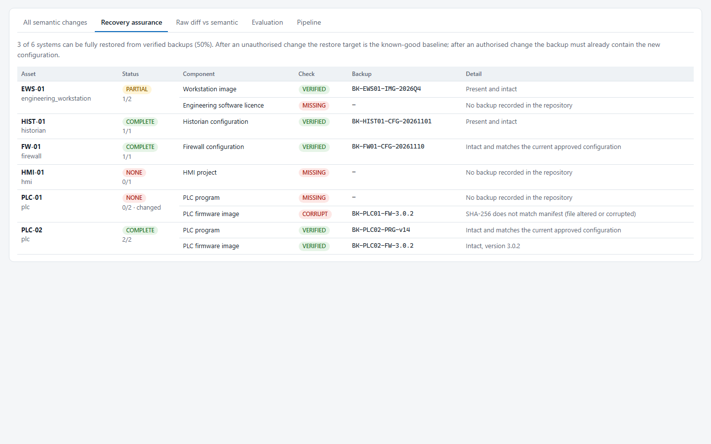

**Local LLM explanation.** llama3.2:3b through Ollama on a laptop CPU (14.6 s); 12 of 12 checked identifiers and values are supported by the evidence.

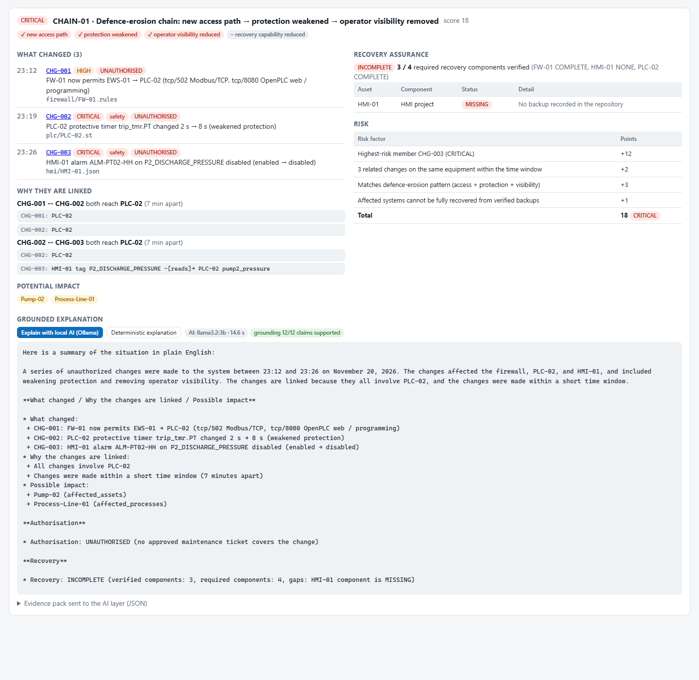

<b>More screenshots:</b> noise control, unrelated changes, approved maintenance, scenario builder, live-folder mode

 

<b>Cosmetic edits ignored (MFG-M3).</b> 3 files and 8 text lines changed, but only 1 semantic change; 2 files hold cosmetic-only edits.

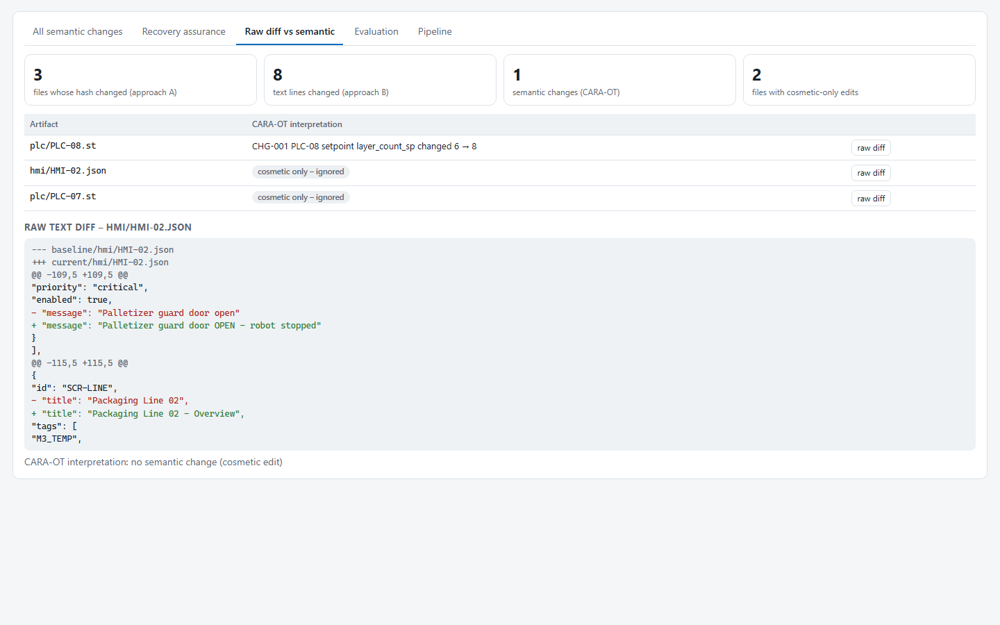

<b>Unrelated changes kept apart (WTR-S4).</b> Two changes on different equipment stay separate, and a firewall rule re-order with the same effect is not reported.

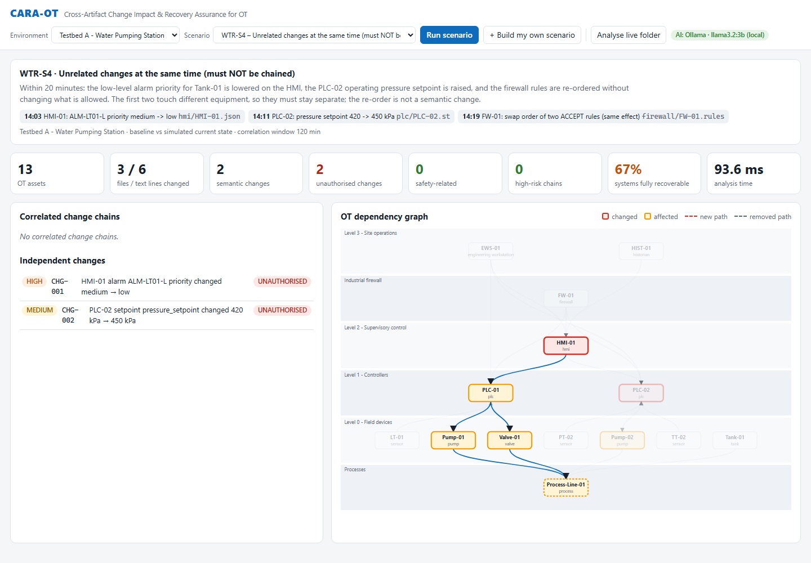

<b>Approved maintenance (WTR-S2).</b> A ticketed setpoint change with a fresh backup is assessed as low risk.

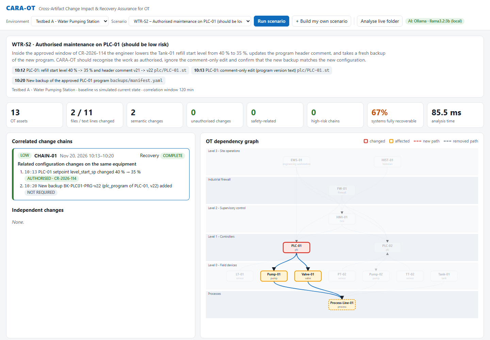

<b>Scenario builder.</b> Changes are picked from drop-downs built from the plant's own files; every run starts from a clean copy of the baseline.

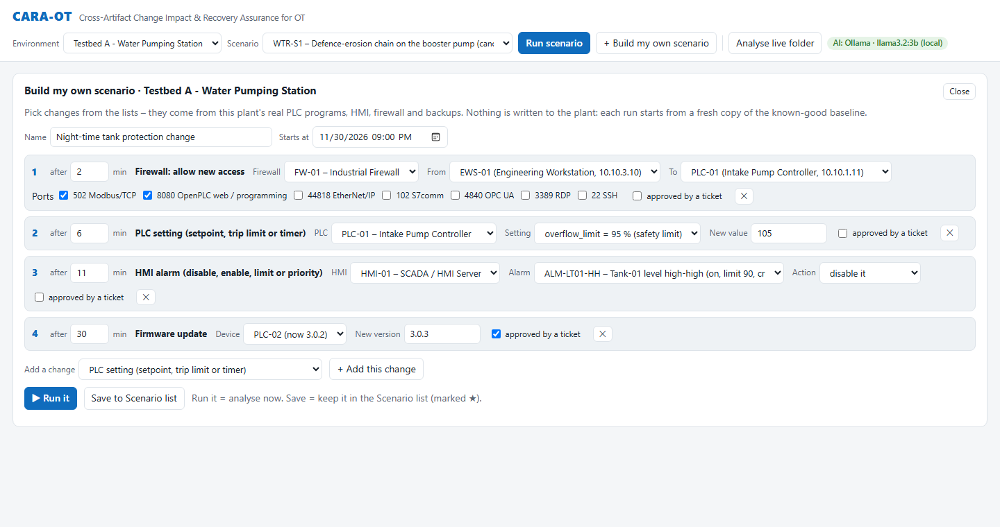

<b>Live-folder mode.</b> A hand edit to a PLC file (motor_temp_limit 80 → 95 °C) is reported as one unauthorised, safety-related change.

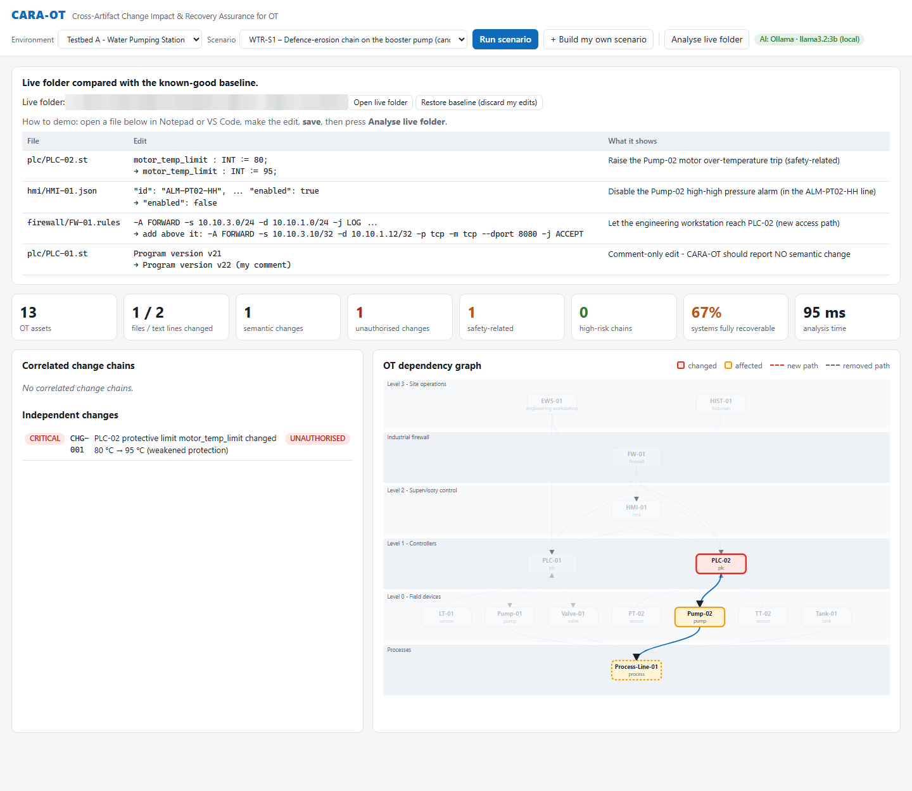

## Results

CARA-OT (E) was compared with four simpler approaches on 12 scenarios across two simulated plants: 26 labelled changes, 5 cosmetic-only edits and 7 true change chains.

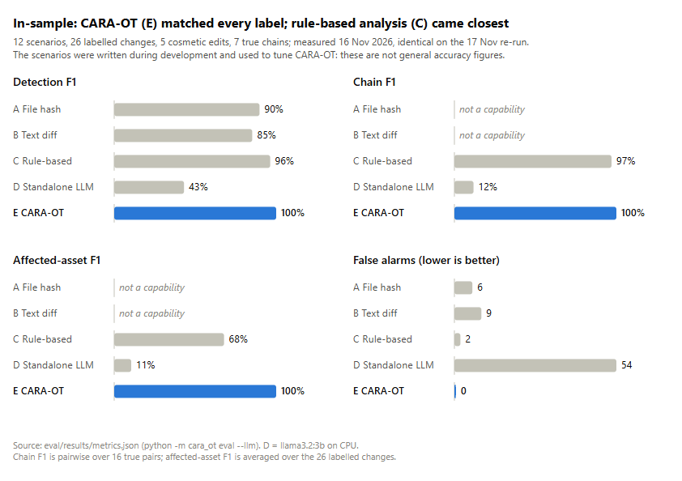

CARA-OT found 26 of 26 changes with 0 false alarms and all 7 chains. The closest baseline, keyword and regex rules, reached 96% detection F1 with 2 false alarms but only 68% affected-asset F1. A standalone LLM given the raw diffs reached 43% detection F1 with 54 false alarms.

> **How to read these numbers.** The 12 scenarios were written while CARA-OT was being built and were used to tune it, so these are in-sample results. They show that the design works as intended, not general accuracy. An independently written, held-out scenario set is the next step.

| Engineering measure | Result |
|---|---|
| Automated tests (pytest) | 28 passed |
| Functional test cases TC-01 to TC-32 | 25 passed (6 on renamed testbed assets), 4 partial, 1 deviation, 1 not implemented, 1 not executed |
| Analysis time | 69 ms mean per scenario over 60 timed runs |
| Scale test | Generated 203-asset environment analysed in 1.1 s |
| Local LLM explanation | 8–15 s on a laptop CPU |
| Code size | ≈ 3,400 lines of Python in the engine, ≈ 830 lines of tests and evaluation, ≈ 890 lines of dashboard |

## Tech stack

| Area | Technology |
|---|---|
| Language | Python 3.13 |
| Web API | FastAPI, Uvicorn |
| Dependency graph | NetworkX |
| Data files | PyYAML, JSON, CSV |
| Local AI | Ollama with llama3.2:3b |
| Dashboard | HTML, CSS and JavaScript, no framework |
| Testing | pytest |
| OT inputs analysed | IEC 61131-3 Structured Text (OpenPLC-compatible), HMI JSON exports, iptables rules, drive parameter CSV, YAML inventory, backup catalogue and maintenance tickets |

## Selected code

[CODE_SNIPPETS.md](CODE_SNIPPETS.md) shows short, unmodified excerpts from the private source: the parser plugin interface, the semantic diff, impact propagation, change correlation, recovery checks and the LLM grounding checker.

## Limitations and next steps

- The two plants are simulated sets of exported files. The PLC programs are OpenPLC-compatible Structured Text but were not run on a PLC runtime.
- The evaluation is in-sample, on self-authored scenarios; there is no held-out set yet.
- Parser coverage is limited to a Structured Text subset, a generic HMI JSON export and iptables TCP rules; PLCopen XML and vendor project formats are not supported.
- Role-based access and report export are not implemented.
- The grounding check verifies identifiers and numbers, not every interpretation in the explanation.

Next: held-out scenarios written by someone who has not seen the engine, an OpenPLC runtime testbed, a PLCopen XML parser and report export.

## About

**Snehansu Nag**, B.Tech in Computer Science and Engineering (Cyber Security), SRM Institute of Science and Technology. Final-year major project, 2026.

The full source code, test evidence and a live demo are available on request; contact me through my GitHub profile.

© 2026 Snehansu Nag. All rights reserved. See [LICENSE](LICENSE).
